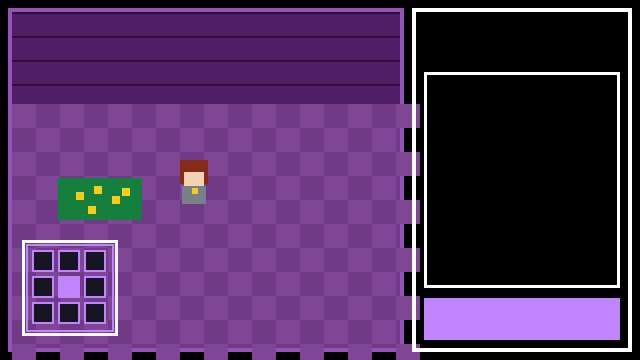
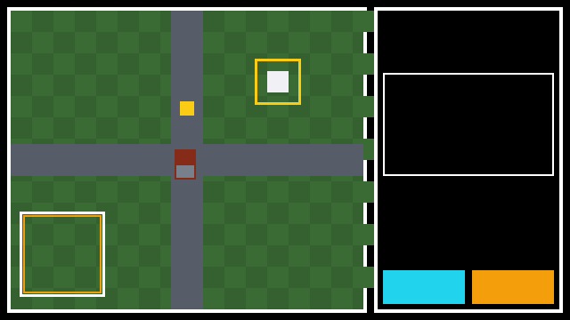
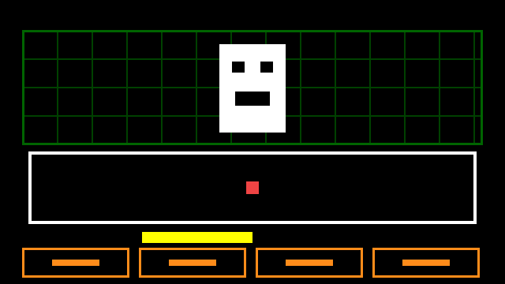

# Loka's Paradox

**Loka's Paradox** is a 2D pixel-art RPG for Android written in **Kotlin + Jetpack Compose**, inspired by classic turn-based & bullet-hell RPGs (*Undertale* and *Deltarune*) while built from scratch with original characters, branching storylines, synthesized PCM chiptune audio, integer nearest-neighbor pixel scaling, and Android 13+ AGSL shader effects.

> **Original Assets Notice:** All sprites, backgrounds, world rules, story dialogue, and synthesized audio (`RetroSoundEngine`) are generated natively in code as original work for this project. No external copyrighted assets or proprietary game files are included.

---

## Visual Showcase

| The Ruins (Tutorial Chambers) | Connected Overworld Realms | Undertale-Style Turn & Dodge Combat |
| :---: | :---: | :---: |
|  |  |  |
| *Purple stone brick halls, flowerbed opening, golden switch, and redesigned 8-way pad.* | *Unified 64×64 pixel sprites, live cross-world chaser bosses, Ashen save plaza, and Soul badges.* | *Monochrome encounter silhouettes, timing-bar strike sparks, arena shake, and bullet-hell dodging.* |

> *Tip: These preview cards illustrate the live in-engine palettes and screen layouts. Feel free to replace `docs/screenshots/*.png` with device captures at any time.*

---

## Story & World

Four races coexist across fractured worlds: **Humans, Monsters, Angels, and Devils**. A child named **Loka** falls into a temporal paradox and awakens inside ancient Ruins before stepping out into a network of connected realms:

- **The Ruins (Tutorial Chambers):** Three connected chambers teaching movement, sprint/walk, switches, and combat basics.
- **Normal World:** Streets, hills, caves, and laboratories — home to the **Red Soul**.
- **Outlands Realm:** Beige desert ridges, cyan groves, and brown caverns — unlocks **Yellow**, **Blue**, and **Split Duo Souls**.
- **The Split Dominion:** Divided territory between Angels (pink-purple groves) and Devils (ash-brown wastes) — unlocks **Purple**, **Olive Green**, and **Split Duo Souls**.
- **The Government HQ:** The central citadel and primary objective. **Lord Cassiel (Angel Leader)** aids Loka, while **Marshal Krog (Monster Chief)** is the only Government leader who can become your friend, and **Chancellor Vance** must be stopped peacefully or by force.
- **The Glitched Void:** An isolated anomaly triggered on Ashen's **8th Save** or via hidden rifts, echoing Loka's past memories before unlocking the final **Echo-Loka** confrontation.

---

## Core Gameplay & Graphics Engine Features

- **Unified 64×64 Crisp Pixel & AGSL Pipeline:**
  - `UltraPixelArtEngine.computeIntegerScaledSize` + `FilterQuality.None` enforces strict integer nearest-neighbor scaling so pixels never blur or stretch unevenly across DPIs.
  - All bosses and monsters are refined from 32×32 grids to unified **64×64** stepped contours (`PixelSprites.sculptGridTo64`) matching Loka's sprite density.
  - Android 13+ (`API 33+`) **AGSL Shaders** (`PixelShaderEffects`) add glitch scanlines in the Glitched Void and chromatic impact flashes in combat (with automatic pre-API-33 fallback and `Reduce Flash` accessibility suppression).
- **Hybrid Combat System:** Classic timing-bar **FIGHT** with slash sparks & screen shake, ordered **ACT** choices (strict **+10% Mercy/Stop per ACT** on bosses; varied percentages on normal monsters), **ITEM**, **ALLY**, **MERCY / STOP**, crimson hurt feedback + shield popups, and a live 60fps bullet-hell arena.
- **Walk & Run Animations & Redesigned Controls:** Switch between Walk and Run (`1.6x` sprint) with animated directional stride frames, pixel dust trails, and a double-beveled retro D-Pad / spoked Joystick (`48dp+` accessible controls throughout).
- **Relics, Equipment & Timelines:** Equip weapons, armors, and Relics; track choices across **Multiple Timelines** where past endings leave echoes across future runs.
- **Multi-Slot Persistence & Audio Settings:** 3 Save Slots (`SharedPreferences` + JSON), difficulty selection (`Easy`, `Normal`, `Hard`), volume control, and `Reduce Flash` accessibility toggle.

---

## Project Architecture

```text
app/src/main/java/com/example/
├── audio/        # RetroSoundEngine (zero-asset PCM BGM & SFX synthesizer)
├── data/         # GameSaveStorage (multi-slot save snapshots & settings)
├── engine/       # Pure Kotlin logic: LokaStats, BattleEngine, TimelineManager
├── model/        # GameModels (worlds, enemies, souls, relics, lore, bullets)
├── viewmodel/    # GameViewModel & BattleViewModel (StateFlow MVIs)
└── ui/
    ├── components/  # UltraPixelArtEngine, PixelArtRenderer, PixelShaderEffects, GameControlsOverlay
    ├── screens/     # LoreIntro, RuinsTutorial, AshenMeeting, WorldExplore, Battle, RouteFinale
    └── theme/       # Material 3 typography, shapes & palette
```

---

## Building & Testing

```bash
# Run unit & Robolectric tests
gradle :app:testDebugUnitTest --offline -Drobolectric.offline=true

# Run Android Lint
gradle lintDebug

# Build debug APK
gradle assembleDebug
```

Automated builds run on GitHub Actions (`.github/workflows/build-apk.yml`) on every push to `main`.

---

## License

Released under the [MIT License](LICENSE).
